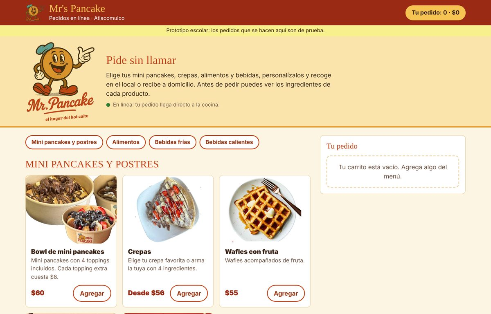
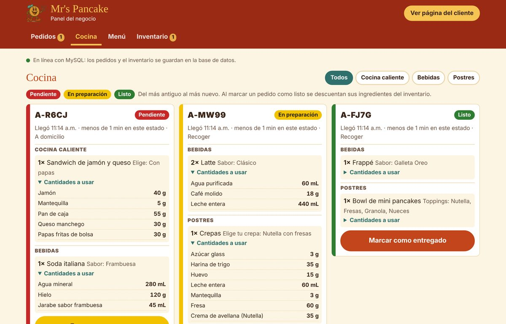
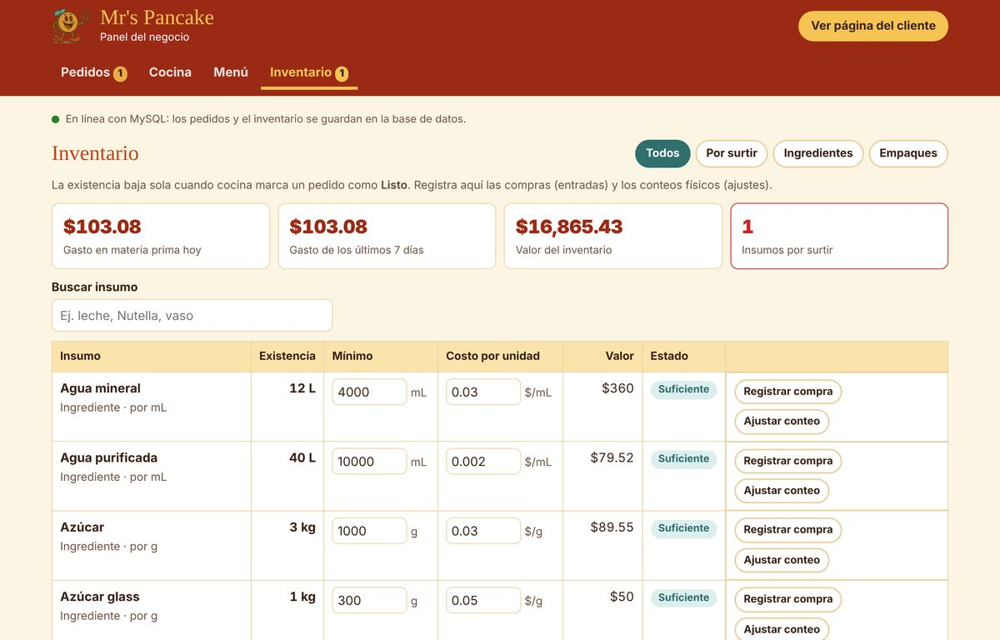

# Rappidos · Sistema web de pedidos para Mr's Pancake

Prototipo escolar de la materia **Administración de Proyectos Informáticos**
(Licenciatura en Ingeniería en Computación, Centro Universitario UAEMex Atlacomulco, periodo 2026B).

Rappidos sustituye la toma de pedidos por WhatsApp y llamadas por un sistema web:
el cliente arma su pedido desde el celular, la cocina lo ve al instante con un semáforo de estados
y el inventario de materia prima se descuenta solo al preparar cada pedido.

> Los pedidos que se hacen en este prototipo son de prueba.

## Qué hace

**Página del cliente** (`index.html`)
- Menú por categorías con fotos y precios.
- Personalización de cada producto (sabor, tamaño, toppings) e ingredientes con sus cantidades.
- Carrito, datos de entrega (recoger en el local o a domicilio) y confirmación con folio.
- Seguimiento del pedido: Pendiente → En preparación → Listo → Entregado.

**Panel del negocio** (`negocio.html`)
- **Pedidos:** lista de pedidos activos y entregados.
- **Cocina:** tarjetas con semáforo (rojo, amarillo, verde) y las cantidades de cada ingrediente a usar.
- **Menú:** alta y baja de productos, cambio de precio y disponibilidad.
- **Inventario:** existencia de cada insumo, compras (entradas), conteos físicos (ajustes),
  gasto en materia prima de hoy y de los últimos 7 días, e insumos por surtir.
  Si no alcanza un insumo, el producto aparece como agotado.

## Capturas

| Cliente | Cocina | Inventario |
|---|---|---|
|  |  |  |

## Tecnologías

- HTML, CSS y JavaScript (sin frameworks).
- PHP 8 con PDO para la API (`api/api.php`).
- MySQL / MariaDB (base de datos `rappidos`: 10 tablas y 1 vista).
- Probado con XAMPP.

## Cómo ejecutarlo con XAMPP

1. Instala XAMPP y en su panel enciende **Apache** y **MySQL**.
2. Copia esta carpeta a `C:\xampp\htdocs\` con el nombre `Rappidos`
   (debe quedar `C:\xampp\htdocs\Rappidos\index.html`).
3. Abre `http://localhost/phpmyadmin`, pestaña **Importar**, elige `bd/rappidos.sql` y presiona **Importar**.
   Si la base ya existía, el archivo borra sus tablas y las vuelve a crear.
4. Si tu MySQL tiene contraseña, escríbela en `api/conexion.php`.
5. Cliente: `http://localhost/Rappidos/index.html`
   Negocio: `http://localhost/Rappidos/negocio.html`

Sin XAMPP también funciona en **modo local** (abriendo `index.html` en el navegador):
los datos se guardan en el navegador y el panel del negocio debe abrirse en el mismo navegador.

## Estructura

```
index.html            Página del cliente
negocio.html          Panel del negocio (Pedidos, Cocina, Menú, Inventario)
css/estilos.css       Estilos con los colores del logo
js/util.js            Estados, categorías, precios y recetas
js/datos-iniciales.js Insumos y menú con recetas (datos de arranque)
js/store.js           Capa de datos: MySQL si hay servidor PHP; si no, el navegador
js/cliente.js         Lógica de la página del cliente
js/negocio.js         Lógica de Pedidos, Cocina y Menú
js/inventario.js      Lógica de la pestaña Inventario
api/conexion.php      Datos de conexión a MySQL
api/api.php           API en PHP (menú, pedidos, estados e inventario)
bd/rappidos.sql       Crea la base de datos con los datos iniciales
img/                  Logo, mascota y fotos de los productos
```

## Base de datos

| Tabla | Qué guarda |
|---|---|
| `insumos` | Materia prima y empaques: existencia, mínimo y costo por unidad |
| `productos` | Menú: precio, categoría, sector de cocina, foto y disponibilidad |
| `opciones`, `elecciones` | Personalización (sabor, tamaño, toppings) y su costo extra |
| `recetas` | Ingredientes de una pieza de cada producto |
| `receta_elecciones` | Lo que agrega cada elección (ej. topping Nutella: 20 g) |
| `pedidos` | Datos del pedido, estado y hora de cada cambio |
| `pedido_productos` | Productos de cada pedido con precio y opciones |
| `pedido_insumos` | Ingredientes que usa cada producto del pedido |
| `movimientos_inventario` | Entradas, salidas (pedidos) y ajustes, con su costo |
| `vista_consumo_insumos` | Vista: cuánto se ha usado de cada insumo y cuánto costó |

El inventario se descuenta **una sola vez**, cuando el pedido pasa a "Listo".
El servidor recalcula el precio y la receta de cada pedido; no confía en lo que manda el navegador.

## Pendiente

- Inicio de sesión por rol para el panel del negocio (hoy no pide contraseña).
- Costo de envío por colonia, asignación de repartidores y confirmación de entrega (Iteración 3).
- Capturar recetas nuevas desde el panel (hoy se hace en phpMyAdmin).
- Validar con el negocio las cantidades de las recetas y los costos de los insumos (son una propuesta del equipo).

## Equipo 7

| Integrante | Rol |
|---|---|
| Jiovani Asael Tapia López | Scrum Master / Analista |
| Luis Ignacio Zaldivar Miranda | Desarrollador Frontend |
| Jaquelin Olivares Hernández | Desarrollador Backend |
| Joselyn Aguirre Alejo | QA y Soporte |

Docente: Linda Angélica Durán López.

El logotipo y las fotos de los productos son de Mr's Pancake y se usan solo para este proyecto escolar.
